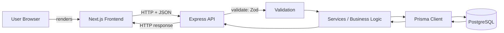
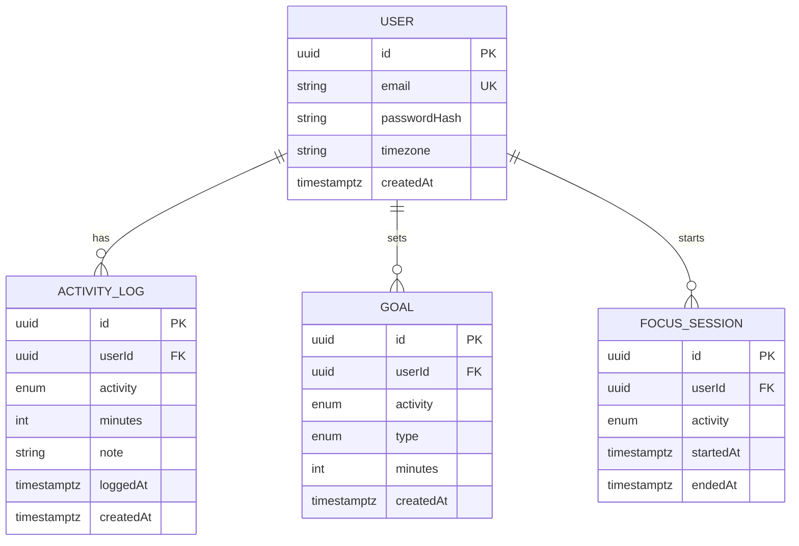
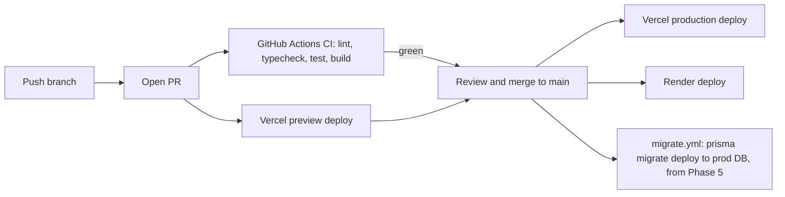

# Detox Tracker: Architecture

## 1. System Overview

Separate frontend and backend so the client-server model is learned properly.



### Responsibilities

| Layer | Responsible for | NOT responsible for |
|---|---|---|
| Frontend (Next.js) | Forms, UI state, showing server responses, calling the API | Trusting its own validation, talking to the DB, holding secrets |
| Backend (Express) | Routing, auth, authorization, validation, business rules | Rendering UI |
| Prisma | Typed DB access, schema, migrations | Business rules |
| PostgreSQL (Supabase) | Persistent storage, constraints, indexes | Application logic |
| GitHub | Source code hosting | Live user data |

## 2. Backend Layering

```
Request
  → middleware (cors, json parser, logger, auth)
  → route          (maps URL + method to a controller)
  → controller     (reads req, calls validation + service, builds res)
  → validation     (Zod schemas)
  → service        (business logic: goals, streaks, ownership rules)
  → repository/Prisma (database access)
  → error middleware (turns thrown errors into consistent JSON)
```

Keep it flat at first (routes + services). Add controller/repository separation only when files get too big to read.

### Target folder scaffold (created empty in Phase 0, filled gradually)

```
detox-tracker/
├── .github/
│   ├── workflows/
│   │   ├── ci-backend.yml        # lint, typecheck, test, build (path-filtered)
│   │   ├── ci-frontend.yml       # lint, typecheck, test, build (path-filtered)
│   │   └── migrate.yml           # prisma migrate deploy to prod (enabled in Phase 5)
│   ├── pull_request_template.md
│   └── dependabot.yml
├── backend/
│   ├── prisma/                   # schema.prisma + migrations/ (Phase 5)
│   ├── src/
│   │   ├── app.ts                # builds the Express app (no listen); easy to test
│   │   ├── server.ts             # starts listening
│   │   ├── config/               # env validation (Zod)
│   │   ├── middleware/           # auth, errorHandler, validate
│   │   ├── routes/               # auth, logs, goals, sessions, dashboard ...
│   │   ├── schemas/              # Zod schemas
│   │   ├── services/             # business logic (streaks, goals ...)
│   │   └── lib/                  # prisma client, helpers
│   ├── tests/
│   │   ├── unit/
│   │   └── integration/
│   ├── .env.example
│   ├── package.json
│   └── tsconfig.json
├── frontend/
│   ├── src/
│   │   ├── app/                  # Next.js routes (login, register, dashboard, logs)
│   │   ├── components/
│   │   ├── lib/                  # api.ts: one place that wraps fetch calls
│   │   └── types/
│   ├── public/
│   └── .env.example
├── docs/
│   ├── decisions/                # ADRs
│   ├── api/                      # API documentation
│   └── notes/                    # learning notes per phase
├── README.md
├── PRD.md  project.md  ARCHITECTURE.md  BUILD_PLAN.md  rules.md
└── .gitignore
```

Empty folders get a `.gitkeep` and a one-paragraph `README.md` explaining what belongs there. Keep the backend flat at first (routes + services); add controller/repository separation only when files get too big to read. Don't add folders beyond this scaffold without a reason.

## 3. Data Model



### Constraints and indexes
- `User.email` unique (store lowercased).
- `ActivityLog.minutes` CHECK between 1 and 1440.
- `ActivityLog.note` max length 280.
- `Goal`: unique `(userId, activity)`; `type` is `TARGET` or `LIMIT`.
- `FocusSession`: at most one row per user with `endedAt IS NULL` (partial unique index or checked in a transaction).
- Index `ActivityLog(userId, loggedAt)` for dashboard and analytics queries.
- Foreign keys use `ON DELETE CASCADE` from User.
- All timestamps stored in **UTC**; "today" is computed in the user's timezone.

### 3.1 Supabase-specific notes

**Supabase is just hosted PostgreSQL for us.** Prisma connects with a normal Postgres connection string, so the schema, SQL and Prisma code are the same as with any Postgres.

**Two connection strings (Project → Connect in the dashboard):**

| | Direct connection | Pooled connection (Supavisor) |
|---|---|---|
| Used for | Prisma migrations (`DIRECT_URL`) | The running Express app (`DATABASE_URL`) |
| Why | Migrations need a stable, full-featured session | Many app connections are shared through a pool, so a small database isn't overwhelmed |
| Watch out | Direct host may be IPv6-only on some plans/networks; if it fails, use the session-mode pooler string for migrations | If using **transaction mode** (port 6543), Prisma needs `?pgbouncer=true` appended to the URL |

Check the exact strings and options in the current Supabase and Prisma docs when you set this up, because they change.

Prisma datasource shape:

```prisma
datasource db {
  provider  = "postgresql"
  url       = env("DATABASE_URL")   // pooled, for the app
  directUrl = env("DIRECT_URL")     // direct, for migrations
}
```

**Security: Row Level Security and the Data API**
- Supabase auto-exposes tables in the `public` schema through its Data API (PostgREST) using a public `anon` key. Tables **without RLS** can be readable or writable by anyone who has that key.
- Our app never uses the Data API: only the Express backend talks to the database, through Prisma with the database role.
- Therefore: **enable RLS on every table** (with no policies, the `anon` and `authenticated` roles get no access) and/or turn off Data API exposure of the `public` schema in project settings. Prisma connects as a privileged role, so it keeps working.
- Never put the Supabase `anon` or `service_role` key in this project. They are not needed. The `service_role` key bypasses all security.
- Ownership checks (`WHERE userId = ...`) in the Express backend remain our real authorization layer.

**Auth stays in Express.** Supabase Auth is a valid alternative, but this project's purpose is to learn authentication, so we implement it ourselves. (Recorded as an ADR below.)

## 4. API Design (v1)

Base path `/api`. JSON only. Auth-required unless noted.

| Method | Path | Purpose | Success |
|---|---|---|---|
| GET | `/health` (no auth) | Liveness check | 200 |
| POST | `/api/auth/register` (no auth) | Create account | 201 |
| POST | `/api/auth/login` (no auth) | Log in | 200 |
| POST | `/api/auth/logout` | Log out | 204 |
| GET | `/api/auth/me` | Current user | 200 |
| POST | `/api/logs` | Create activity log | 201 |
| GET | `/api/logs?from=&to=&activity=` | List own logs | 200 |
| PATCH | `/api/logs/:id` | Edit own log | 200 |
| DELETE | `/api/logs/:id` | Delete own log | 204 |
| PUT | `/api/goals/:activity` | Create/update goal | 200 |
| GET | `/api/goals` | List goals with today's progress | 200 |
| DELETE | `/api/goals/:activity` | Remove goal | 204 |
| POST | `/api/sessions/start` | Start focus session | 201 |
| POST | `/api/sessions/stop` | Stop session and create log | 200 |
| GET | `/api/sessions/active` | Current running session | 200 |
| GET | `/api/dashboard/today` | Totals + goals + recent logs | 200 |
| GET | `/api/streaks` | Streak per goal | 200 |
| GET | `/api/analytics/summary?range=week|month` | Aggregates for charts | 200 |

### Example: `POST /api/logs`

Request
```json
{ "activity": "STUDY", "minutes": 60, "note": "Java DSA practice" }
```

Success `201`
```json
{ "log": { "id": "…", "activity": "STUDY", "minutes": 60, "note": "Java DSA practice", "loggedAt": "2026-10-17T10:30:00.000Z" } }
```

Errors
- `400` invalid body: `{ "error": { "code": "VALIDATION_ERROR", "message": "…", "details": [ … ] } }`
- `401` not logged in
- `500` unexpected, generic message only

### Status code usage
`200` OK · `201` Created · `204` No content · `400` Invalid input · `401` Not authenticated · `403` Not allowed · `404` Not found · `409` Conflict (e.g. duplicate email, session already running) · `429` Too many requests · `500` Server error

## 5. Authentication Design

**Status: decision pending (Phase 6).** Record the final choice in `docs/decisions/001-auth.md`.

| | Server-side sessions | JWT |
|---|---|---|
| What the client holds | Random session ID (in a cookie) | Self-contained signed token |
| Where state lives | Server/DB (session store) | In the token |
| Logout / revoke | Easy: delete the session | Hard: token valid until expiry unless a denylist is added |
| Scaling | Needs shared session store | Stateless |
| Fit for this app | Good: one backend, one DB, simple | Works, but adds complexity we don't need yet |

Notes to remember:
- **JWT is a token format. Cookies are a transport mechanism.** A JWT can be sent in a cookie, or in an `Authorization` header; a session ID is also usually sent in a cookie.
- Leaning (to be confirmed after learning both): **server-side sessions stored in PostgreSQL**, sent as an HttpOnly cookie, because revocation is simple and there is a single backend.
- Password hashing: argon2 or bcrypt, never a plain SHA/MD5.
- Authorization rule: every query on user data includes `WHERE userId = <session user>`.

### Cookies across domains
Vercel (frontend) and Render (backend) will be on **different domains**. This makes cookies cross-site: the cookie needs `SameSite=None; Secure`, CORS must allow the exact frontend origin with `credentials: true`, and the frontend must send `credentials: "include"`. Some browsers restrict third-party cookies, so a custom domain with a shared parent domain (or a Next.js proxy/rewrite to the backend) may be needed. Plan to test this early in deployment rather than at the end.

## 6. Focus Timer Design

- `POST /sessions/start` stores `startedAt = now()` on the server.
- `POST /sessions/stop` sets `endedAt = now()`, computes minutes = rounded duration, creates an `ActivityLog`, and returns it, all in one DB transaction.
- The client only *displays* a ticking clock (computed from `startedAt`); it never sends the duration.
- Guards: one active session per user; maximum duration cap; ignore sessions shorter than 1 minute.

## 7. Streak Design

A pure function (no DB inside) so it can be tested thoroughly:

```
computeStreak(goal, dailyTotals[], today, timezone) → { current, longest }
```

Rules are defined in `PRD.md` (FR-6). Edge cases to test: no logs, today incomplete, a missed day, limit goal with zero logs (no data ≠ success), timezone/midnight boundary, DST change.

## 8. Environments and Configuration

| Variable | Where | Notes |
|---|---|---|
| `DATABASE_URL` | backend | Supabase **pooled** connection string; used by the running app. Never in frontend |
| `DIRECT_URL` | backend (local/CI/release only) | Supabase **direct** connection string; used by Prisma migrations |
| `SESSION_SECRET` (or `JWT_SECRET`) | backend | Long random value |
| `FRONTEND_ORIGIN` | backend | For the CORS allow-list |
| `NODE_ENV` | backend | `development` / `production` / `test` |
| `NEXT_PUBLIC_API_URL` | frontend | The `NEXT_PUBLIC_` prefix makes it visible to the browser, so **no secrets here** |

Validate env vars at startup with Zod; crash early with a clear message if one is missing.

### Env matrix (where each variable lives)

| Variable | Local `.env` | GitHub Actions secret | Render | Vercel |
|---|---|---|---|---|
| `DATABASE_URL` (pooled) | dev DB | no (CI uses a service container) | prod DB | never |
| `DIRECT_URL` (direct) | dev DB | prod DB, for `migrate.yml` only | optional | never |
| `SESSION_SECRET` / `JWT_SECRET` | dev value | test value (dummy) | prod value | never |
| `FRONTEND_ORIGIN` | `http://localhost:3000` | n/a | prod frontend URL | n/a |
| `NODE_ENV` | `development` | `test` | `production` | set by Vercel |
| `NEXT_PUBLIC_API_URL` | `http://localhost:4000` | dummy for builds | n/a | prod backend URL |

Rules: use **different secret values per environment**; production values are entered only in the platform dashboards; `.env.example` is the only env file in Git.

## 9. Testing Strategy

| Level | Tool | What |
|---|---|---|
| Unit | Vitest | Streak logic, goal progress, validation schemas |
| Integration | Vitest + Supertest + test DB | Endpoints, auth, ownership checks |
| Manual | Postman | Exploratory API testing; keep a saved collection |
| End to end (later) | Playwright (optional) | Register → log → dashboard |

## 10. Environments, CI/CD and Deployment

### Deployment architecture

```
GitHub ──(push/PR)──▶ GitHub Actions (CI)
   │
   ├──▶ Vercel  (Next.js frontend)  ──HTTPS──▶  Render (Express API)  ──TLS──▶  Supabase (PostgreSQL)
   └──▶ Render  (auto-deploy main)
```

### Environments

| Environment | Purpose | Database |
|---|---|---|
| Local | Day-to-day development | Supabase `detox-dev` |
| CI | Automated tests on every PR | Throwaway Postgres service container |
| Preview | Vercel deploy per PR for review | `detox-dev` (or frontend-only) |
| Production | The live app | Supabase `detox-prod` |

Separate databases protect production data from experiments and bad migrations.

### CI/CD pipeline



| Stage | Tool | Trigger | Gate |
|---|---|---|---|
| CI backend | GitHub Actions | PR / push touching `backend/**` | Must pass to merge |
| CI frontend | GitHub Actions | PR / push touching `frontend/**` | Must pass to merge |
| Preview deploy | Vercel | Every PR | Visual check |
| Frontend prod deploy | Vercel | Merge to `main` | CI green |
| Backend prod deploy | Render | Merge to `main` (prefer "after CI passes") | CI green |
| DB migration | GitHub Actions `migrate.yml` | Merge to `main` touching `backend/prisma/**` | CI green; uses `DIRECT_URL` secret |

Migration rules: migrations are generated and reviewed in a PR, applied to prod **only by CI**, and must be backward compatible with the currently running backend (add columns before using them; remove them in a later release).

### Rollback
- Vercel: promote a previous deployment.
- Render: redeploy a previous successful deploy.
- Database: forward-fix with a new migration; take a backup/export before risky migrations (check what Supabase backups the current plan includes).

### Notes
- Run the pipeline drill (PR → green CI → preview → merge → prod) in Phase 0 before any feature exists.
- Supabase free projects can be **paused after inactivity**, and Render's free tier can cold-start. Verify current behaviour and limits.
- Choose Supabase and Render regions close to each other.
- Cross-site cookie behaviour is tested in Phase 6 and re-checked in production in Phase 9.

## 11. Architecture Decision Records (to write in `docs/decisions/`)

1. `001-auth.md`: sessions vs JWT.
2. `002-separate-frontend-backend.md`: why not Next.js API routes only (answer: learning client-server separation).
3. `003-express-over-nestjs.md`: lightweight, fundamentals first.
4. `004-time-and-timezones.md`: UTC storage, user-timezone days.
5. `005-supabase-as-database.md`: use Supabase only as managed Postgres (not Auth/Data API); pooled vs direct connections; RLS enabled.
6. `006-ci-cd.md`: GitHub Actions for CI, Git-based deploys on Vercel and Render, migrations through CI.
7. `007-environments.md`: local / CI / preview / production, separate dev and prod databases, env matrix.
8. `008-infrastructure-first.md`: why services, env files, CI/CD and folder scaffold come before feature code.

## 12. Deliberately Out of Scope

Docker, Redis, queues, microservices, GraphQL, WebSockets, automatic screen-time capture. Revisit only with a concrete problem that needs them.
